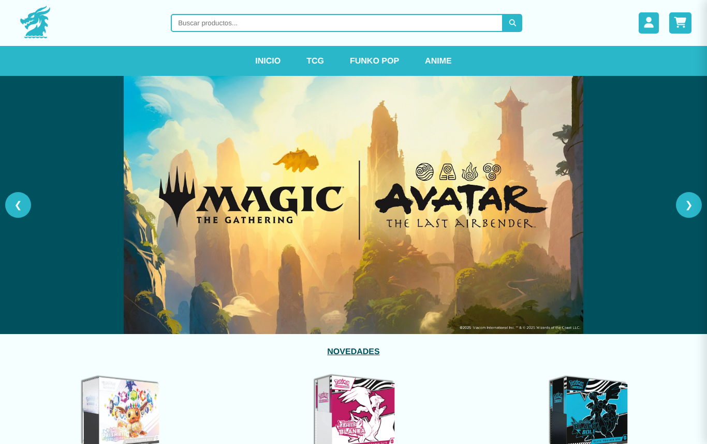
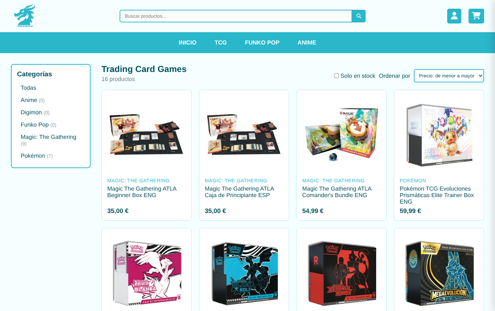
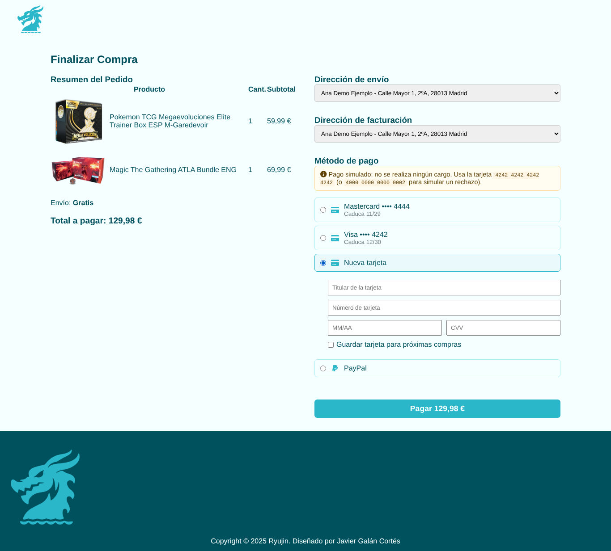
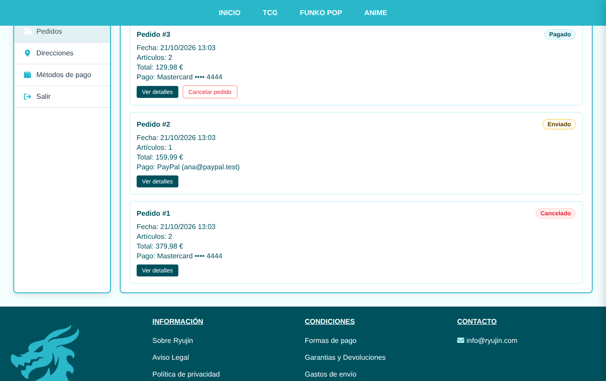
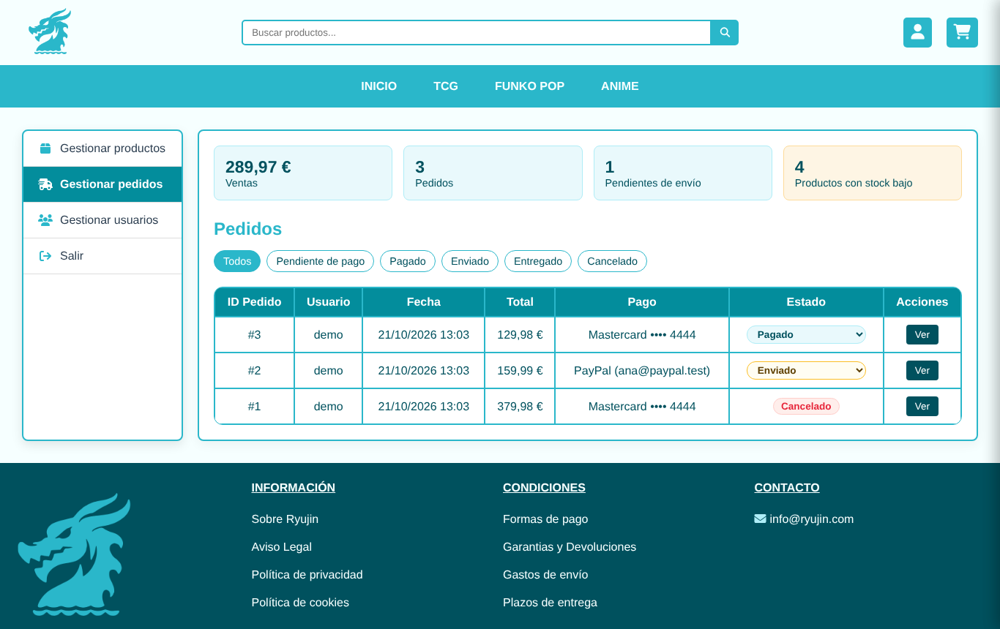
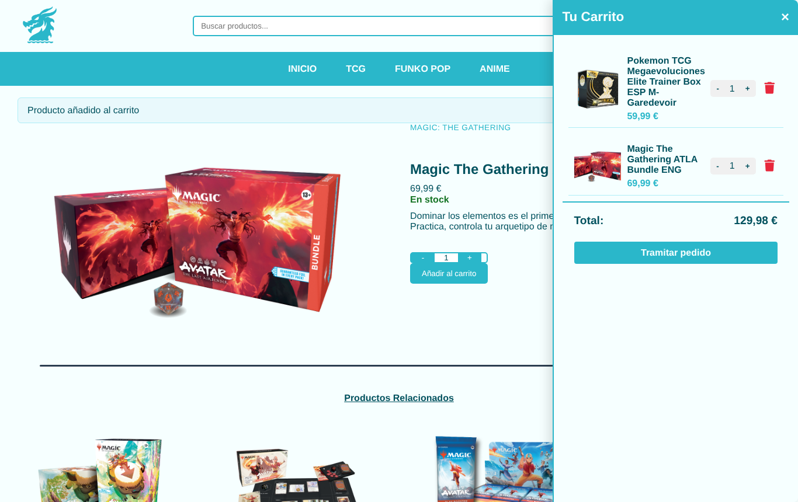
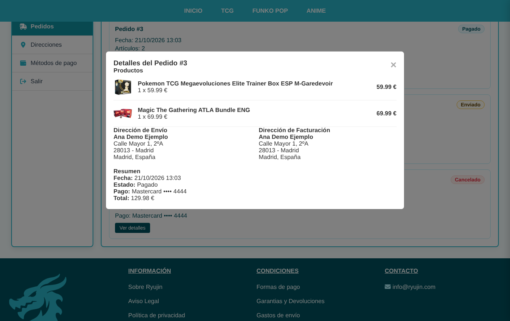
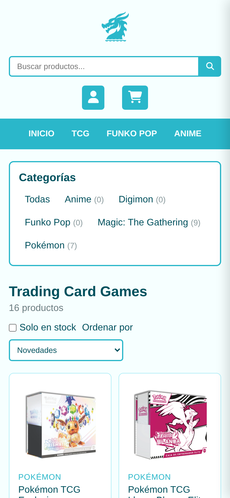

# Ryujin · Tienda online de TCG

Tienda online de **Trading Card Games** (Pokémon, Magic: The Gathering, Digimon), Funko Pop y merchandising de anime,
desarrollada como **Trabajo de Fin de Grado** con PHP, MySQL y JavaScript sin frameworks.



## Funcionalidades

### Tienda
- **Catálogo** con buscador (nombre, descripción y categoría), filtro por categoría o sección (TCG, Funko Pop, Anime),
  filtro "solo en stock", ordenación por precio/nombre/novedad y paginación.
- **Ficha de producto** con disponibilidad de stock y productos relacionados.
- **Carrito** en panel lateral con límite de 5 unidades por producto y control de stock.
  Es **persistente**: se guarda en la base de datos y se recupera al volver a iniciar sesión.
- **Checkout** con direcciones de envío y facturación (se pueden crear sin salir de la página)
  y **pago simulado** con tarjeta (validación Luhn, caducidad y CVV) o PayPal.

### Área de cliente
- Edición de datos de la cuenta y **cambio de contraseña**.
- **Historial de pedidos** con estado (pendiente, pagado, enviado, entregado, cancelado), detalle en ventana modal
  y **cancelación** de pedidos aún no enviados, que repone el stock automáticamente.
- Gestión de **direcciones** y **métodos de pago** guardados.

### Panel de administración
- Indicadores: ventas, nº de pedidos, pedidos pendientes de envío y productos con stock bajo.
- CRUD de **productos** con subida de imágenes.
- **Gestión de pedidos**: cambio de estado y filtro por estado.
- **Gestión de usuarios**: cambio de rol y eliminación.

| Catálogo | Checkout |
|---|---|
|  |  |
| **Pedidos del cliente** | **Panel de administración** |
|  |  |
| **Carrito** | **Detalle de pedido** |
|  |  |

<p align="center"></p>

## Seguridad

- Contraseñas cifradas con **bcrypt** y regeneración del identificador de sesión al iniciar sesión.
- **Consultas preparadas** (PDO) en todos los accesos a la base de datos.
- **Tokens CSRF** en todos los formularios que modifican datos.
- Escapado de toda la salida HTML (también en el JavaScript que pinta datos del servidor) para evitar **XSS**.
- Comprobación de propiedad: un usuario solo puede ver o modificar sus pedidos, direcciones y métodos de pago.
- Los **precios y el stock se leen siempre de la base de datos** al crear el pedido, dentro de una transacción
  con bloqueo de filas (`SELECT ... FOR UPDATE`) para evitar vender el mismo stock dos veces.
- Subida de imágenes validando el tipo real del archivo (no la extensión) y con nombre aleatorio.
- De las tarjetas **solo se guardan la marca, los 4 últimos dígitos y la caducidad**; nunca el número completo ni el CVV.

## Tecnologías

- **Backend:** PHP 8 (PDO)
- **Base de datos:** MySQL / MariaDB
- **Frontend:** HTML5, CSS3 (diseño responsive, sin frameworks) y JavaScript (ES6)
- **Iconos:** Font Awesome

## Instalación (XAMPP)

1. Clona el repositorio dentro de `htdocs`:
   ```bash
   git clone https://github.com/javierg2032/tfg.git
   ```
2. Crea la base de datos `ryujin` en phpMyAdmin e importa `database/ryujin.sql`.
3. Copia `.env.example` como `.env` y ajusta los datos de conexión y del administrador.
   El administrador se crea automáticamente la primera vez que se abre la web.
4. Abre `http://localhost/tfg/` en el navegador.

> **¿Ya tenías la base de datos de la versión entregada del TFG?** Ejecuta `database/migracion_portfolio.sql`
> para añadir las tablas y columnas nuevas sin perder datos.

### Datos de prueba

| | Usuario | Contraseña |
|---|---|---|
| Cliente | `demo` | `demo1234` |
| Administrador | el definido en `.env` | el definido en `.env` |

Tarjetas para el pago simulado (cualquier caducidad futura y cualquier CVV de 3 cifras):

| Número | Resultado |
|---|---|
| `4242 4242 4242 4242` | Pago aceptado (Visa) |
| `5555 5555 5555 4444` | Pago aceptado (Mastercard) |
| `4000 0000 0000 0002` | Pago rechazado |

## Estructura del proyecto

```
├── index.php, catalogo.php, producto.php   Páginas de la tienda
├── carrito.php, checkout.php, pedido_confirmado.php
├── perfil.php, admin.php                   Área de cliente y panel de administración
├── info.php                                Páginas informativas (aviso legal, envíos...)
├── includes/                               Cabecera, pie y modal compartidos
├── php/
│   ├── config.php                          Conexión PDO (lee .env)
│   ├── funciones.php                       Seguridad, carrito, pagos y pedidos
│   └── *.php                               Controladores de formularios y peticiones
├── js/script.js
├── css/style.css
├── assets/                                 Imágenes de productos y anuncios
└── database/                               Volcado SQL y migración
```

## Autor

**Javier Galán Cortés** · Trabajo de Fin de Grado

Las marcas e imágenes de productos pertenecen a sus respectivos propietarios y se usan únicamente con fines educativos.
